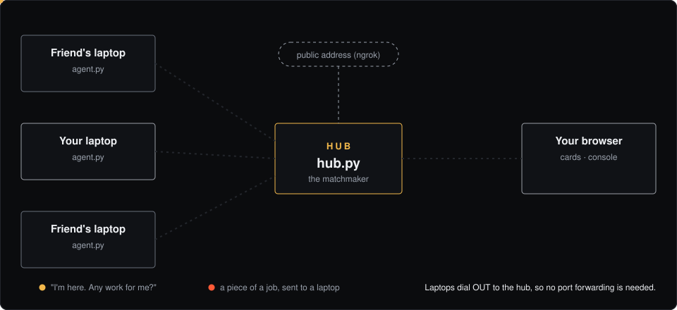
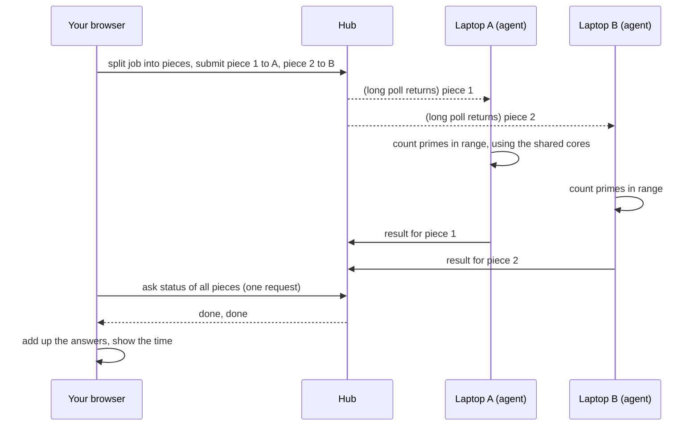
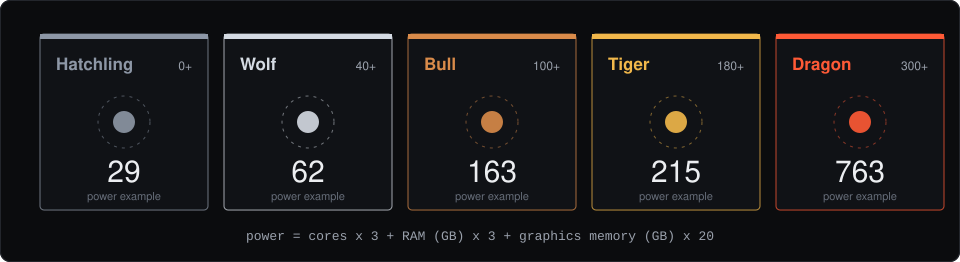

<p align="center">
  
</p>

<p align="center">
  <b>Pool your laptop and your friends' laptops into one crew.</b><br>
  Every machine gets a collector-style power card. You see them all on one web page,<br>
  and you split real jobs across them with a click, or with a command in the built-in console.
</p>

<p align="center">
  <a href="#quick-start-you-are-the-host">Quick start</a> ·
  <a href="#invite-a-friend">Invite a friend</a> ·
  <a href="#the-console">Console</a> ·
  <a href="#how-a-job-gets-split">How jobs split</a> ·
  <a href="#safety">Safety</a> ·
  <a href="#troubleshooting">Troubleshooting</a>
</p>

---

## Contents

1. [What it is](#what-it-is)
2. [What it can and can't do](#what-it-can-and-cant-do)
3. [How it works](#how-it-works)
4. [Power cards and tiers](#power-cards-and-tiers)
5. [Quick start (you are the host)](#quick-start-you-are-the-host)
6. [Invite a friend](#invite-a-friend)
7. [Using the web page](#using-the-web-page)
8. [The console](#the-console)
9. [How a job gets split](#how-a-job-gets-split)
10. [Safety](#safety)
11. [Works over the internet](#works-over-the-internet)
12. [Big crews](#big-crews)
13. [Command line tools](#command-line-tools)
14. [API reference](#api-reference)
15. [Files in this repo](#files-in-this-repo)
16. [Troubleshooting](#troubleshooting)
17. [Roadmap](#roadmap)
18. [Older Tailscale mode](#older-tailscale-mode)

---

## What it is

Manifold links several computers into one **crew**.

- Each laptop runs a tiny program called the **agent**. It tells a central **hub** what the laptop has: CPU cores, RAM, and graphics card.
- You open a web page and see every laptop as a **power card**, with a tier like Wolf, Tiger or Dragon.
- You press **Run power test** (or type a command in the console) and the page cuts a job into pieces, sends the pieces to every laptop that is sharing, and adds up the answers.

Nobody has to open ports or fiddle with a router. Friends join with **one invite link and one command**.

<p align="center">
  
</p>

---

## What it can and can't do

**Honest version first.** Manifold does not make one computer faster for normal apps or games. It speeds up work that can be **cut into independent pieces**.

| Works well | Does not work |
|---|---|
| Counting, searching and brute-force jobs (the built-in test does this today) | Playing a game faster on your laptop |
| Rendering frames, encoding video clips (planned, see [Roadmap](#roadmap)) | Making a browser or editor feel quicker |
| Batch jobs: OCR, transcribing, test suites (planned) | Anything where every step needs the last step's answer |
| Hash cracking for labs and CTFs (planned, the best fit) | Real-time graphics (the network is too slow) |

**What exists today:** one built-in job, *count the primes below N*. It is a real workload that splits perfectly, so it is a good way to prove the whole system (cards, invites, scheduling, drop-outs, cancel) before adding heavier jobs.

---

## How it works

Three parts:

| Part | File | What it does |
|---|---|---|
| **Hub** | `hub.py` | The matchmaker. Keeps the list of machines, pairing codes, invites and the job queue. Also serves the web page. Python standard library only. |
| **Agent** | `agent.py` | Runs on every laptop. Sends specs, then waits for work. Runs only built-in tasks. |
| **Page** | `web/index.html` | Your control panel. Shows cards, runs jobs, hosts the console. |

**Agents dial out.** Each agent makes outgoing web requests to the hub, the same way a browser loads a site. That is why it works behind home routers, college Wi-Fi and phone hotspots without opening any ports.

**Idle is quiet.** An idle agent asks "any work?" and the hub holds that request open for up to 20 seconds (a long poll). A new job wakes it instantly, and nothing is hammered in between.

What happens when you start a job:



The **browser is the job controller.** The hub only passes pieces and results along. All the scheduling logic lives in the page, so a hub can stay small.

---

## Power cards and tiers

Every machine gets a **power score** from the three things that matter most for shared work:

```
power = CPU cores x 3  +  RAM in GB x 3  +  graphics memory (VRAM) in GB x 20
```

Graphics memory is weighted heavily because it is the scarce, valuable part when you want to run bigger models.

<p align="center">
  
</p>

| Tier | Starts at | Looks like |
|---|---|---|
| 🐣 **Hatchling** | 0 | Old or small laptop |
| 🐺 **Wolf** | 40 | Decent everyday laptop |
| 🐂 **Bull** | 100 | Good CPU and plenty of RAM |
| 🐯 **Tiger** | 180 | Gaming laptop with a GPU such as an RTX 4050 |
| 🐉 **Dragon** | 300 | Workstation or high-end GPU |

Example: a laptop with 16 cores, 15.8 GB RAM and a 6 GB RTX 4050 scores `48 + 47 + 120 = 215`, so it is a **Tiger**.

The **Combined power** number at the top of the page is the sum of every machine that is online, and the colored ribbon shows each machine's share.

---

## Quick start (you are the host)

The host runs the hub and also takes part in the crew. You need **Python 3** and a terminal (WSL on Windows works well).

### 1. Get the code

```bash
git clone https://github.com/neminorniel24-droid/manifold_super_pcx.git
cd manifold_super_pcx
```

### 2. Start it

**Same Wi-Fi only (simplest):**

```bash
python3 host.py --no-tunnel
```

**With friends over the internet** (see [Works over the internet](#works-over-the-internet) for ngrok setup):

```bash
# terminal 1
ngrok http 8080

# terminal 2
python3 host.py --public-url https://YOUR-NAME.ngrok-free.dev
```

`host.py` does everything in one go:

1. starts the hub,
2. registers your own laptop and starts its agent with sharing on (using half your cores by default),
3. prints the link to your page and opens it in your browser.

You will see something like:

```
Your page:  http://127.0.0.1:8080/#key=<your-private-key>
Friends join with an invite link (create one on the page).
```

> The `#key=...` part is **your private key**. Anyone with that link can act as your machine, so keep it to yourself. The page saves it in your browser and removes it from the address bar.

### 3. See your card

Your laptop appears as a power card with its tier, score, cores, memory and graphics card. That is a working crew of one. Add a friend to combine power.

### host.py options

| Option | Meaning |
|---|---|
| `--port 8080` | Port for the hub and page |
| `--name "My laptop"` | Name shown on your card |
| `--max-cores N` | Most cores friends may use on **this** machine (default: half) |
| `--public-url URL` | Use your own tunnel address (ngrok etc.) |
| `--no-tunnel` | Local network only |
| `--no-browser` | Don't open the page automatically |
| `--state PATH` | Where your machine's key is saved (default `agent_state.json`, already in `.gitignore`) |

---

## Invite a friend

On your page, find **Invite a friend**.

1. Pick **how many people** can use the link (1, 5, 10 or 25).
2. Click **Create invite link**, then **Copy**.
3. Send it to your friend. It looks like `https://your-address/join/AbC123...`

The link expires after **48 hours** and stops working once its people are used up. **Cancel all open invite links** kills every open link at once.

### What your friend does

They open the link. It shows two commands. They run the one for their system:

**Windows (PowerShell):**

```powershell
powershell -NoProfile -ExecutionPolicy Bypass -Command "irm -Headers @{'ngrok-skip-browser-warning'='1'} 'https://your-address/install.ps1?token=THEIR_TOKEN' | iex"
```

**Linux, WSL or macOS:**

```bash
curl -fsSL -H "ngrok-skip-browser-warning: 1" "https://your-address/install.sh?token=THEIR_TOKEN" | bash
```

(The join page fills in the real address and token for them. Copy from the page, not from this README.)

The command downloads the small agent, registers the laptop, **joins your crew automatically**, and starts sharing. They need Python 3 installed. The window prints:

```
Joined Nemin's crew.
Your pairing code: K7X-92P
Sharing ON: connected friends may use up to 4 of your 8 cores. Keep this window open.
```

Within seconds, their card appears on your page.

### What your friend is agreeing to

The join page says it plainly: the person who invited them can use **up to half their CPU cores** to run built-in jobs. Nothing else. See [Safety](#safety).

### To stop sharing

- Close the window, or press `Ctrl+C`. Their card goes offline after about 30 seconds.
- To leave the crew for good, use **Leave this crew** on the host's card in their own page.

### Another way: pairing codes

Every machine has a code like `K7X-92P`. If you have a friend's code, type it in **Have their pairing code instead?** and press **Send request**. They get a request on their page and choose **Accept** or **Decline**. Both sides must agree.

---

## Using the web page

<table>
<tr><td width="34%"><b>Top bar</b></td><td>How many machines are online, the <b>Console</b> button, and your pairing code (click to copy).</td></tr>
<tr><td><b>Combined power</b></td><td>Big number, a ribbon with one colored block per machine, and totals for CPU cores, memory and graphics memory across everyone online.</td></tr>
<tr><td><b>Your card</b></td><td>Your machine, with tier, score, specs and your pairing code.</td></tr>
<tr><td><b>Your crew</b></td><td>Every machine as a card, <b>online first, then by power</b>. Hover a card for a gentle tilt. Offline machines are dimmed. Big crews show the first 24 (8 on a phone) with a <b>Show all</b> button and <b>Hide offline</b>.</td></tr>
<tr><td><b>Remove</b></td><td>Under each friend's card. It takes <b>two clicks</b> so a stray tap can't drop someone.</td></tr>
<tr><td><b>Put the crew to work</b></td><td>Runs a 5 million prime-counting job across every machine that is online and sharing, then times your machine alone, and shows the speedup.</td></tr>
<tr><td><b>Invite a friend</b></td><td>Create and cancel invite links (see above).</td></tr>
<tr><td><b>Requests</b></td><td>When someone sends you a pairing request, it shows at the top with <b>Accept</b> and <b>Decline</b>.</td></tr>
</table>

The page updates itself every few seconds. It also respects "reduce motion" settings.

---

## The console

Click **Console** in the top bar, or press the **backtick key** (`` ` ``). A terminal opens at the bottom of the page.

<p align="center">
  
</p>

### Commands

| Command | What it does |
|---|---|
| `help` | List everything |
| `status` / `status --all` | The crew as a table, with totals. `--all` includes offline machines |
| `run primes <n>` | Split a prime-counting job across the crew. `n` can be `500k`, `5m`, `1e6` and so on (min 1000, max 200m) |
| `run primes <n> --compare` | Also time this machine alone and print the speedup |
| `run primes <n> --on <machine>` | Run on one machine only. Use a name, a pairing code, or `me` |
| `ping` | Three round trips to the hub, in milliseconds |
| `invite [people]` | Make a join link for 1 to 25 people (and copy it) |
| `remove <machine> [--yes]` | Drop a machine from your crew. It asks you to confirm with `--yes` |
| `whoami` | Your name, code and tier |
| `history` | Your last commands |
| `clear` | Clear the screen |
| `workflow list` | Show saved workflows |
| `workflow save <name> "<commands>"` | Save a chain of commands |
| `workflow run <name>` | Run a saved chain |
| `workflow rm <name>` | Delete one |

### Workflows

A **workflow** is just a saved chain of commands separated by `;`. It runs step by step and **stops at the first error**.

```text
crew › workflow save nightly "status; run primes 20m --compare"
Saved "nightly". Run it with:  workflow run nightly

crew › workflow run nightly
```

Workflows are saved in **your browser**, so they stay on this device. You can also chain commands directly, with no saving:

```text
crew › status; whoami
```

Machine names with spaces need quotes: `run primes 5m --on "Nemin 4050"`.

### Keys

| Key | Action |
|---|---|
| `` ` `` | Open or close the console |
| `Up` / `Down` | Walk through your history |
| `Tab` | Complete commands, options, workflow names and machine names |
| `Ctrl+C` | Cancel a running job |
| `Ctrl+L` | Clear the screen |
| `Esc` | Close the console |

### Cancelling

`Ctrl+C` stops every piece **nobody has started yet**. A piece a laptop is already crunching finishes first, because a running task can't be interrupted from outside. That is why very large jobs are capped at 200 million, so a "finish first" never takes long.

---

## How a job gets split

This is the part that makes many laptops act like one. The page does it for every job:

<p align="center">
  
</p>

1. **Cut.** The job range is cut into pieces. By default **4 pieces per machine**. Very large jobs get more, so no single piece is huge.
2. **Hand out.** Each machine holds at most **2 pieces at a time**. The page gives the next piece to whichever machine is least busy for its size (share of cores), so **faster machines naturally take more pieces**.
3. **Collect.** It checks the status of every piece with **one request**, not one per piece, so 40 machines don't flood the hub.
4. **Recover.** If a laptop goes offline or errors, its piece is **re-sent** to another machine. A piece that fails 3 times stops the job with a clear message.
5. **Race the slow piece.** Near the end, idle laptops get a **duplicate** of any piece that is taking much longer than the others. **The first answer wins**, and the slow copy is ignored. One slow old laptop can't hold up the whole crew.
6. **Add up.** All the answers are summed. You get the total, the time, and how many pieces each machine did.

With `--compare` (or the page's power test), the page then times your machine **alone** on the same job, so the speedup is measured, not guessed.

**Known answers** you can check: primes below 1,000,000 = **78,498**; below 2,000,000 = **148,933**; below 5,000,000 = **348,513**.

> Small jobs may show little or no speedup. Cutting up and sending work takes time too. Try `run primes 50m --compare` to see a real difference.

---

## Safety

Manifold is built so that sharing a laptop is low-risk, and always something the owner chose.

| Rule | What it means |
|---|---|
| **Sharing is opt-in** | An agent only runs work if sharing is on. Joining through an invite link turns it on and says so on the join page. |
| **Built-in tasks only** | The hub accepts one known task, `count_primes`. Nobody can send a command, a script or a file to run on your laptop. |
| **Limits on every job** | Number ranges are checked and capped. Pieces that run too long (15 minutes) are treated as lost. |
| **Core cap** | The agent never uses more than your set share of cores. The default is **half**. Change it with `--max-cores`. |
| **Only specs are shared** | Name, CPU model, cores, RAM, graphics card name and memory. No files, no browsing, no screen. |
| **Who can send work to whom** | A person who joined through your invite **cannot** send work to you or to other members. Only you (the host) can send work to them. Pairing-code friends can work on each other once both accept. |
| **Private key links** | Your page uses a private key kept in your browser. Keys are not shown to other people. |
| **Invites expire** | 48 hours, limited uses, and you can cancel them all at once. |
| **Console is safe** | Output is shown as plain text, so a machine called `<script>` can't run code in your page. |
| **Secrets stay local** | `hub_data.json` and `agent_state.json` are in `.gitignore`. Check `git status` before every push. |

**Please only invite people you trust.** An invite link adds anyone who has it.

---

## Works over the internet

Agents only need to reach the hub's web address. Pick one way to give the hub a public address:

| Way | Good for | Notes |
|---|---|---|
| **ngrok** (recommended) | Most people | Free account. Works on school and mobile networks. |
| **Cloudflare quick tunnel** | Quick tests | `host.py` tries it automatically without `--public-url`. Some networks block its port (7844), and then it fails. |
| **Tailscale** | Friends you know well | Private network, no public address. See [Older Tailscale mode](#older-tailscale-mode). |
| **Cloud server** | Always on | A small VPS running `hub.py --host 0.0.0.0` behind a normal address. Then the host's laptop doesn't need to stay on. |

### ngrok setup (once)

```bash
# install from https://ngrok.com/download, then:
ngrok config add-authtoken <your-token>
ngrok http 8080
```

It prints a `Forwarding` address such as `https://something.ngrok-free.dev`. Keep that terminal open, then start Manifold with `python3 host.py --public-url https://something.ngrok-free.dev`.

If your network blocks ngrok, try a **phone hotspot**. Scripts talking to ngrok need the header `ngrok-skip-browser-warning`. The join commands already include it.

---

## Big crews

Manifold is built for **dozens of machines**, not just four. It was load-tested with more than 40 simulated laptops (a mix of fast, slow and offline ones), and the checks covered correct answers, drop-outs, and slow machines.

What makes that work:

- **Long polling** instead of constant asking: idle traffic dropped from roughly 87 to 7 requests per second in tests.
- **Batch status:** one request checks up to 500 pieces.
- **Limited concurrency:** the page sends only a few submits at a time.
- **Smart shelf:** online machines first, and a "Show all" button instead of hundreds of cards at once.
- **Invites for groups:** one link can add up to 25 people.

---

## Command line tools

You don't need these for normal use, but they exist.

**`agent.py`** runs on a laptop and joins a hub:

```bash
python3 agent.py --hub https://HUB --invite TOKEN --allow-jobs
python3 agent.py --hub http://127.0.0.1:8080 --name "My laptop" --allow-jobs --max-cores 4
```

| Option | Meaning |
|---|---|
| `--hub` | Hub address (required) |
| `--name` | Name on your card (default: computer name) |
| `--invite` | Invite token from a friend's link |
| `--allow-jobs` | Let your crew run built-in jobs here. Without it, sharing is OFF |
| `--max-cores` | Most cores others may use (default: half) |
| `--state` | Where to save its key (default `agent_state.json`) |

**`hub.py`** runs the hub on its own:

```bash
python3 hub.py --port 8080 --public-url https://your-address
```

| Option | Meaning |
|---|---|
| `--host` | Address to listen on (default `0.0.0.0`) |
| `--port` | Port (default 8080) |
| `--public` | Open a free Cloudflare tunnel |
| `--public-url` | Your own public address |

**`crew_run.py`** splits a job from the terminal, without the page:

```bash
python3 crew_run.py --hub http://127.0.0.1:8080 --n 5000000
```

---

## API reference

Everything is plain JSON over `POST`. Your private key goes in `secret`.

| Endpoint | Purpose |
|---|---|
| `/api/register` | Register a machine (optionally with an `invite`). Returns code and secret |
| `/api/heartbeat` | Refresh specs and sharing status |
| `/api/crew` | Your card, your friends and incoming requests |
| `/api/connect`, `/api/respond` | Send, accept or decline a pairing request |
| `/api/disconnect` | Remove a machine or leave a crew |
| `/api/invite`, `/api/invite/revoke_all` | Create (size 1 to 25) or cancel invite links |
| `/api/job/submit` | Send one piece to one machine |
| `/api/job/poll` | Agent asks for work. `wait` makes it hold up to 25 s |
| `/api/job/result` | Agent returns an answer |
| `/api/job/status`, `/api/job/statuses` | Check one or many pieces |
| `/api/job/cancel` | Cancel pieces that haven't started |

Public `GET` routes: `/` (the page), `/join/<token>`, `/api/invite/<token>`, `/install.sh`, `/install.ps1`, `/dl/agent.py`, `/dl/manifold.py`.

---

## Files in this repo

```
manifold_super_pcx/
├── hub.py          the matchmaker and web server (standard library only)
├── agent.py        runs on every laptop
├── host.py         one command: hub + your agent + browser
├── crew_run.py     split a job from the terminal
├── manifold.py     spec detection and the prime counter, plus the older token mode
├── setup.sh        readiness check for the older Tailscale mode
├── web/
│   ├── index.html  the page: cards, scheduler, console
│   └── join.html   the invite landing page
└── docs/           animated diagrams used in this README
```

---

## Troubleshooting

| What you see | What it means and what to do |
|---|---|
| `Address already in use` | An old hub is still running. Run `pkill -f hub.py` and start again. |
| Page says "Link this browser to your laptop" | Your key is missing or the hub forgot you. Start the agent again and open the new link it prints. |
| Console says **No machine is sharing right now** | No agent has sharing on. Start one with `--allow-jobs`, or use `host.py`. |
| Job errors with `404` | The hub wasn't restarted after an update. Stop it and start it again. |
| Friend's command downloaded a script but nothing happened | In Git Bash the token was a placeholder. Use the **PowerShell** command from the join page. |
| `invite link is invalid or used up` | The link expired, was cancelled, or all its places are taken. Make a new one. |
| Cloudflare `Error 1033`, or QUIC/HTTP2 blocked | Your network blocks the tunnel port. Use ngrok with `--public-url`. |
| ngrok `ERR_NGROK_4018` | Add your token: `ngrok config add-authtoken <token>`. |
| ngrok certificate error | Try another network or a phone hotspot. |
| Card shows an old name or an offline friend | Use **Remove** on the card, or `remove <name> --yes` in the console. |
| WSL shows less RAM than your laptop has | WSL limits memory by default. Set `memory=` in `C:\Users\<you>\.wslconfig`, then run `wsl --shutdown`. |
| Console `Ctrl+C` didn't stop it at once | Pieces already running finish first. Queued pieces are cancelled. |
| `git push` includes secret files | Stop. Check `.gitignore` has `hub_data.json` and `agent_state.json`, and run `git status` first. |

**First, check you're in the right folder.** If git says "not a git repository", run `cd ~/manifold_super_pcx`.

---

## Roadmap

Planned in rough order of usefulness:

- [ ] **Hash cracking** for labs and CTFs, using each laptop's GPU (hashcat), with the wordlist split across the crew
- [ ] **Blender frame rendering** and **ffmpeg video clip encoding**
- [ ] **Batch jobs** such as OCR, audio transcription and test suites
- [ ] **Bigger AI models** by splitting a model's layers over several GPUs (llama.cpp RPC)
- [ ] **A hosted hub**, so the host's laptop doesn't have to stay on
- [ ] **Job history and crew roles**
- [ ] **Saved workflows that follow you** across devices

New jobs are added as **safe built-in tasks**, never "run this code", so the safety model above keeps holding.

---

## Older Tailscale mode

The first version used a shared token and a private network, with no web page. It still works and lives in `manifold.py`:

```bash
# on every machine, same private network (Tailscale)
curl -fsSL https://tailscale.com/install.sh | sh && sudo tailscale up

python3 manifold.py init                           # main machine: make workers.json and a token
python3 manifold.py worker --token <token>         # every machine
python3 manifold.py status                         # combined cores, RAM, VRAM
python3 manifold.py run --n 2000000 --compare      # demo job across everyone
python3 manifold.py llm --model mymodel.gguf       # commands to split an LLM over all GPUs
```

Only expose these workers on Tailscale or a trusted local network, never the open internet. `setup.sh` checks that a WSL machine is ready.

---

<p align="center"><sub>Made by Nemin. Share your compute only with people you trust.</sub></p>
